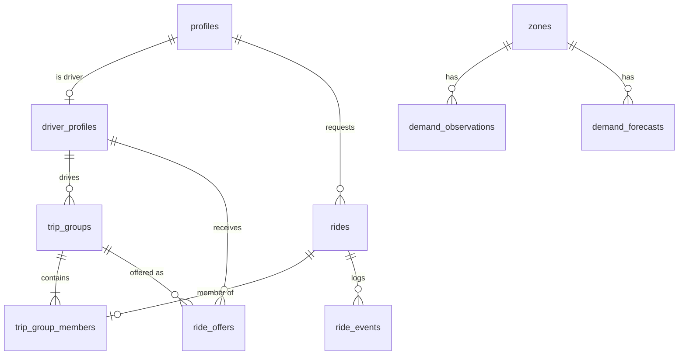
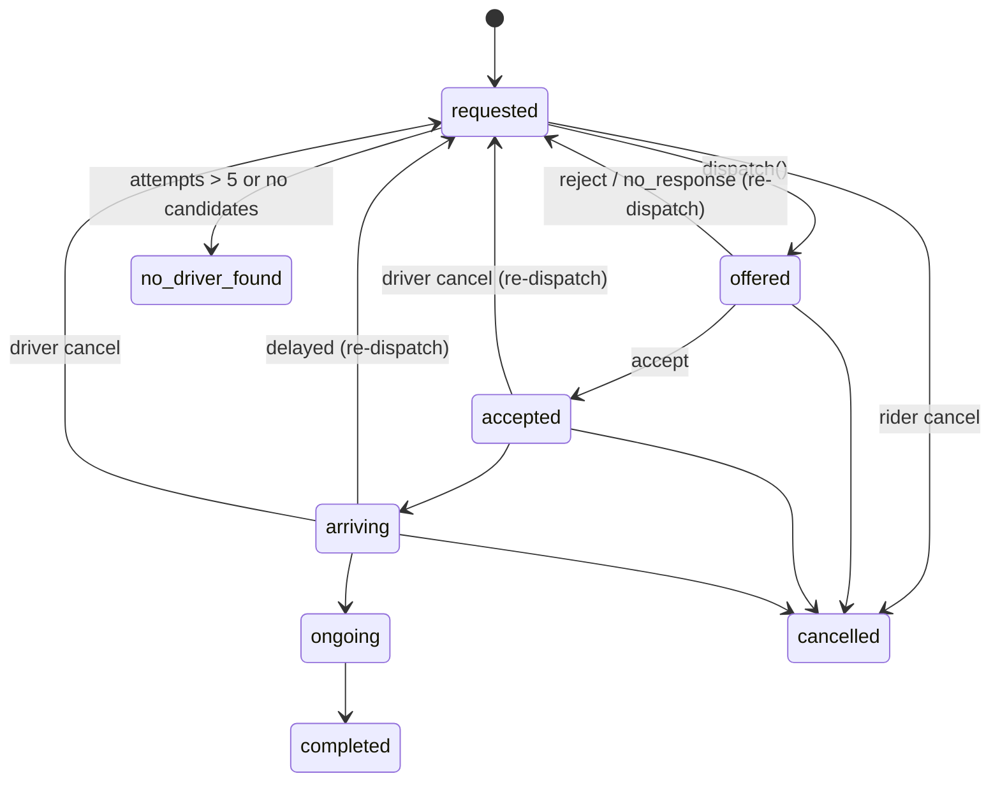

# Data Model

Supabase Postgres 15+ with PostGIS in the `extensions` schema. All IDs are `uuid` except zones (`smallint`) and events (`bigint identity`).

## Tables
| Table | Key columns | Notes |
|---|---|---|
| `profiles` | `id → auth.users`, `role check (rider,driver,admin)`, `display_name` | Created by an auth trigger from signup metadata. A trigger blocks the owner from changing `role`. `admin` is assigned only in the seed. |
| `driver_profiles` | `user_id pk → profiles`, `online`, `location geography(Point,4326)`, `vehicle_category check (bike,auto,cab)`, `vehicle_label`, `plate`, `idle_since`, `trips_today`, `offers_received`, `offers_accepted` | GiST index on `location`. |
| `rides` | `rider_id`, `pickup/dropoff geography`, labels, `category`, `status`, `est_distance_km`, `est_trip_min`, `est_pickup_min`, `fare jsonb`, `surge`, `requested_at…completed_at`, `cancelled_at` | One passenger request. `status` mirrors its group, plus `requested/no_driver_found/cancelled`. |
| `trip_groups` | `driver_id null`, `status`, `is_pool`, `stops jsonb`, `attempt_no` | One vehicle journey. A solo ride is a group with 1 member. |
| `trip_group_members` | `group_id`, `ride_id unique`, `pickup_seq`, `drop_seq`, `detour_min`, `fare_share` | `ride_id unique` puts a ride in at most one group. |
| `ride_offers` | `group_id`, `driver_id`, `attempt_no`, `score`, `components jsonb`, `outcome check (pending,accepted,rejected,no_response,cancelled,expired_superseded)`, `offered_at`, `expires_at`, `responded_at` | Full allocation evidence. |
| `ride_events` | `id identity`, `ride_id`, `group_id`, `actor`, `type`, `from_status`, `to_status`, `payload jsonb`, `at` | Append-only: no UPDATE/DELETE grant and RLS select only. |
| `zones` | `id smallint`, `name`, `kind`, `center geography` | 8 Belagavi (Belgaum) zones, centres from OpenStreetMap. A point belongs to the nearest centre (Voronoi). |
| `demand_observations` | `zone_id`, `ts`, `demand`, `rain`, `incident` | SIMULATED. |
| `demand_forecasts` | `zone_id`, `target_ts`, `scenario`, `predicted`, `actual null`, `model_version` | Produced by `ml/train.py`. |
| `model_runs` | `version`, `model`, `mae`, `baseline_mae`, `features jsonb`, `train_rows`, `test_rows`, `trained_at` | |
| `settings` | single row: weights, `offer_timeout_s`, `fast_demo`, `delay_threshold_min`, `surge_cap`, `surge_alpha`, `pool_max_detour_pct`, `sim_clock` | Admin-writable only. |

## Integrity rules (enforced in the database)
1. **One active trip group per driver:** `unique (driver_id) where status in ('accepted','arriving','ongoing')` on `trip_groups`.
2. **At most one pending offer per group:** `unique (group_id) where outcome='pending'`.
3. **No driver holds two pending offers:** `unique (driver_id) where outcome='pending'`.
4. **A ride sits in at most one group:** `trip_group_members.ride_id unique`. A group has one `driver_id` column, so a ride can never have two drivers.
5. Every state-changing RPC locks rows in a fixed order: `trip_groups` → `driver_profiles` (ascending id) → `ride_offers`. It then revalidates status, expiry and eligibility, and maps `unique_violation` to a clean `conflict` error.
6. Every status change inserts into `ride_events` inside the same transaction.

## State machine (group level; member rides mirror it)

Allowed transitions live in one SQL table (`ride_transitions(from,to,actor_role)`), which `advance_trip` checks.

Limitation: pooled passengers share the group lifecycle. There is no per-passenger "dropped off" state.
