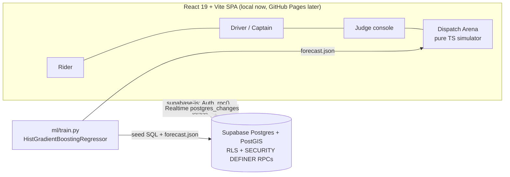

# Urban Pulse: Implementation Plan

Status: approved by Salman on 13 Nov 2026 (plan-mode review). This doc is the single source of truth for architecture. The other docs in `docs/` cover the data model, RPC contract, simulator, scenarios and demo.

## 1. Architecture



- **No Node/Express API.** GitHub Pages is static-only, so every integrity-critical operation (dispatch, scoring, offer response, state transitions, reassignment, pooling validation, admin metrics) is a hardened Postgres function called with `supabase.rpc()`. Identity always comes from `auth.uid()`.
- **Backend rubric risk:** PS 02 names Node.js, Django and Spring Boot as backend examples. Ask a mentor at the 5:30 PM evaluation whether Postgres RPCs satisfy "backend". If not, a thin Node wrapper over the same RPCs is about 1 hour of work, and needs Salman's approval first.
- **Dispatch Arena** runs fully in the browser as deterministic TypeScript (`src/sim/`). It never touches live ride tables.

### Why Supabase Postgres over MongoDB
| | Supabase Postgres + PostGIS | MongoDB Atlas + Better Auth |
|---|---|---|
| Ride lifecycle integrity | FK + CHECK + partial unique indexes + row locks in one transaction | Hand-written transactions and retry logic |
| Geo | PostGIS `geography` + GiST index, `ST_DWithin` | GeoJSON + `2dsphere` (equally viable) |
| Auth | Built-in, JWT feeds RLS | Separate provider to configure |
| Realtime | Built-in `postgres_changes` | Separate Socket.io server |
| Hosting with GitHub Pages | Works (anon key + RLS) | Needs an API host |

MongoDB can handle the geo side. We picked Postgres for integrity, auth and realtime in a single service.

## 2. Repo layout and ownership
```
src/pages/{auth,rider,driver,judge}/   Shiv
src/components/{ui,map,ride,arena}/    Shiv
src/lib/  supabase.ts geo.ts allocation.ts pooling.ts surge.ts   Salman
src/sim/  rng.ts scenario.ts world.ts metrics.ts forecast.json   Salman + Neel
supabase/migrations/*.sql  supabase/seed.sql                     Salman
ml/train.py                                                      Salman + Neel
docs/                                                            all (Sujal: matrix, Neel: arena/scenarios)
```
Two people never edit the same file at the same time. Branches are `feature/*` and merge to `main` through a PR, with Salman as the merge gate.

## 3. Stack (pinned at install)
React 19, TypeScript, Vite, Tailwind v4, shadcn/ui, Lucide, React-Leaflet + OSM tiles (with attribution), TanStack Query, @supabase/supabase-js, Zod (forms), Vitest, Playwright, pnpm, Supabase CLI via `pnpm dlx supabase@<pinned>`.
Not used until a concrete need appears: Zustand, Motion, 21st.dev, Watermelon UI, React Bits (each needs a licence check before adoption).
Geocoding uses about 20 seeded Bengaluru demo places, so there is no Nominatim autocomplete. Routing is haversine × 1.35 road factor with an hour-based speed, labelled "estimated".

## 4. Screens / component tree
- `/login`, `/signup`: role choice (rider/driver); demo accounts listed in dev.
- `/rider`: `MapCanvas` (zones, drivers, pins, route) + `BookingPanel` (left on desktop, bottom sheet on mobile): `PlaceSelect` ×2 (connected pickup→drop) → `CategoryList` (Bike/Auto/Cab with ETA + fare) → `RequestButton` → `RideTracker` (status steps, attempt #, driver card) → `FareBreakdown`; `/rider/history`.
- `/driver`: `OnlineToggle`, `OfferCard` (pickup, drop, ETA, fare, countdown, Accept/Reject), `TripControls`, `/driver/history` + utilization.
- `/judge` tabs: **Live** (map + rides + drivers), **Allocation** (offers + score bars + weight sliders + re-rank), **Zones** (heatmap, forecast vs actual, surge formula, repositioning, model card), **Pooling**, **Chaos** (event log + inject buttons), **Metrics**, **Arena** (A/B + What-If).
- Every simulated surface carries a `SIMULATED` badge. Every query has loading, empty and error states.

## 5. Algorithms (short form; formulas live in DISPATCH_ARENA.md)
- **ETA/fare:** `dist = haversine × 1.35`; speed is 18 km/h at peak (8–10, 17–20) and 26 otherwise; bike ×1.15 speed. `fare = (base + perKm·km + perMin·min) × surge`. Per category: bike ₹20/₹6/₹1, auto ₹30/₹11/₹1.5, cab ₹50/₹15/₹2.
- **Allocation (D):** for each eligible driver, components are min-max normalised over the candidate set: `eta = 1−norm(pickup_eta)`, `workload = 1−norm(trips_today)`, `reliability = (accepted+4)/(received+5)`, `idle = norm(idle_min)`. `score = .45·eta + .25·workload + .20·reliability + .10·idle` (weights in `settings`). Ties go to the lower driver id. The **baseline** policy is argmin pickup ETA.
- **Reassignment (E):** on reject, timeout, driver cancel or delay: mark the offer, exclude that driver for this group, `dispatch()` again, `attempt_no++`. After 5 attempts or with no candidates left, status becomes `no_driver_found`.
- **Surge (B):** `raw = clamp(1 + 0.15·max(0, forecast/max(supply,1) − 1), 1, cap)`; `smoothed = α·raw + (1−α)·prev` with α = 0.5. The UI shows every input.
- **Repositioning (B):** a greedy loop. For the zone with the largest gap, move the nearest idle driver from a zone with surplus. Repeat until the gaps are closed or the surplus runs out.
- **Pooling (C):** two rides are compatible if pickups are within 1.5 km and drops are within 2.5 km. Try every valid stop order (P before D per rider; 6 orders for 2 riders) and pick the minimum total time where each rider's detour stays ≤ 40%. Each rider pays 75% of their solo fare. Limit: 2–3 riders, straight-line legs.
- **Forecast (A):** see §7.

## 6. Realtime and authorization
- Realtime subscriptions: rider → own `rides` row + its `trip_groups`; driver → `ride_offers` where `driver_id = uid` and own active group; judge → all (admin role). RLS on every table gates every subscription.
- `profiles.role` cannot be changed by its owner (trigger). Admin exists only through the seed. The service-role key never reaches the browser.

## 7. Forecasting model
1. Synthetic history: 8 zones × 42 days × 30-min buckets, seed 42. Per-zone hourly curve × weekday factor × rain (+30%) × incident (+60%), with Poisson noise.
2. Features: zone, hour, half-hour, day-of-week, weekend, rain, incident, lag1, lag48 (yesterday), lag336 (last week), 4-bucket rolling mean.
3. Target: demand 30 min ahead. Model: `HistGradientBoostingRegressor`.
4. Chronological split: days 1–35 train, 36–42 test. Metric: MAE against the seasonal-naive baseline (same time last week).
5. Outputs: `supabase/seed_forecast.sql` (observations, forecasts and a `model_runs` row) and `src/sim/forecast.json` (test-week forecasts plus **scenario variants**: rain and incident are real model inputs; rush hour is a labelled deterministic adjustment).
6. Fallback if sklearn will not install: a seasonal-naive heuristic labelled "heuristic, not a trained model".

## 8. Delivery (local IST, recalculated at 12:50 PM)
| Window | Deliverable |
|---|---|
| 12:50–1:00 | docs, repo |
| 2:00–3:15 | foundation: Vite/shadcn, Supabase migrations + seed, auth + role routing |
| 3:15–5:30 | core slice: estimate → request → dispatch → accept/reject → lifecycle → history, realtime. **5:30 checkpoint** |
| 7:00–9:00 | allocation UI, reassignment + Chaos RPCs, train model, zones/surge/repositioning, pooling core |
| 10:00–12:00 | Arena A/B: request stream, isolated worlds, metric cards |
| 12:30–1:30 | Arena rerun, determinism tests, split-screen polish |
| 1:30–3:30 | What-If Lab |
| 3:30–4:30 | Chaos Mode polish, pooling route visual. **Feature freeze 4:30** |
| 4:30–5:45 | QA, Playwright, screenshots, backup video, push |

## 9. Local setup and environment
`.env.local`: `VITE_SUPABASE_URL`, `VITE_SUPABASE_ANON_KEY` (both public by design). Commands:
`pnpm i` → `pnpm dlx supabase start` → `pnpm dlx supabase db reset` → `pnpm dev`. Python is only needed to retrain (`ml/train.py`); its output is committed.

## 10. Testing and acceptance
- Vitest: geo/fare, allocation (ranking changes with workload/idle), pooling (order, detour cap), surge (worked example 10/5 → 1.15), sim determinism (same seed → identical JSON) and isolation (worlds share no references).
- SQL smoke (`supabase/tests/smoke.sql`): request → offer → reject → second offer is attempt 2; a second pending offer for the same driver violates the unique index; two concurrent `respond_offer` calls produce one winner.
- Playwright: rider + driver lifecycle; Chaos reject → reassignment visible to the rider; zones page; arena run.
- Screenshots at 1440×900 and 390×844 per major screen.

## 11. Risks and fallbacks
| Risk | Fallback |
|---|---|
| Docker / image pulls fail | Hosted Supabase dev project, same migrations |
| sklearn on Python 3.14 fails | Labelled heuristic (partial requirement) |
| OSM tiles blocked | Zones and markers on a blank canvas; list view |
| Google Maps requested | Decided against for the hackathon (docs/MAP_PROVIDER_DECISION.md) |
| GitHub unreachable | Commit locally, push at breaks |
| Mentor rejects RPC-as-backend | Thin Node wrapper (approval needed) |
| Arena overruns | Single scenario, fewer controls |

## 12. What judges see
A real rider → driver ride with realtime state; an allocation explanation with alternatives; Chaos buttons that run the real reassignment RPC; a zone heatmap from a trained model with MAE vs baseline; transparent surge; repositioning; a pooled route with calculated savings; Dispatch Arena comparing nearest-driver and Urban Pulse on the same seed, with honest metrics.
